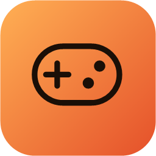
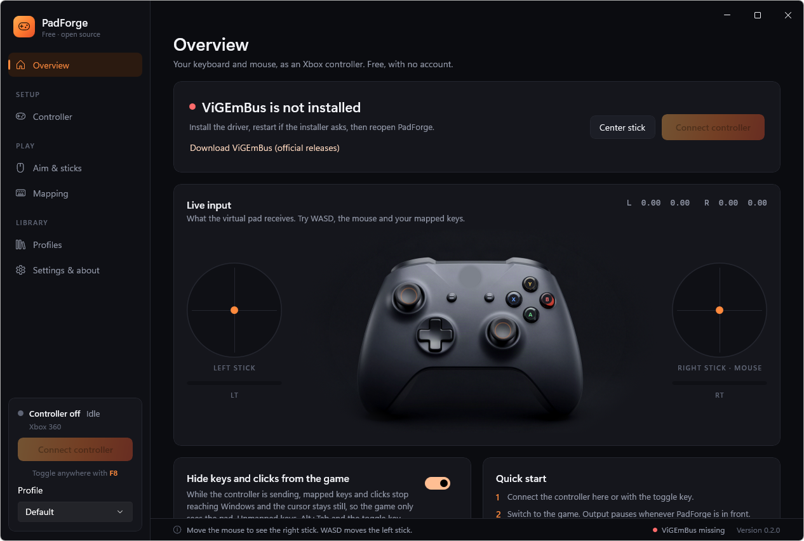
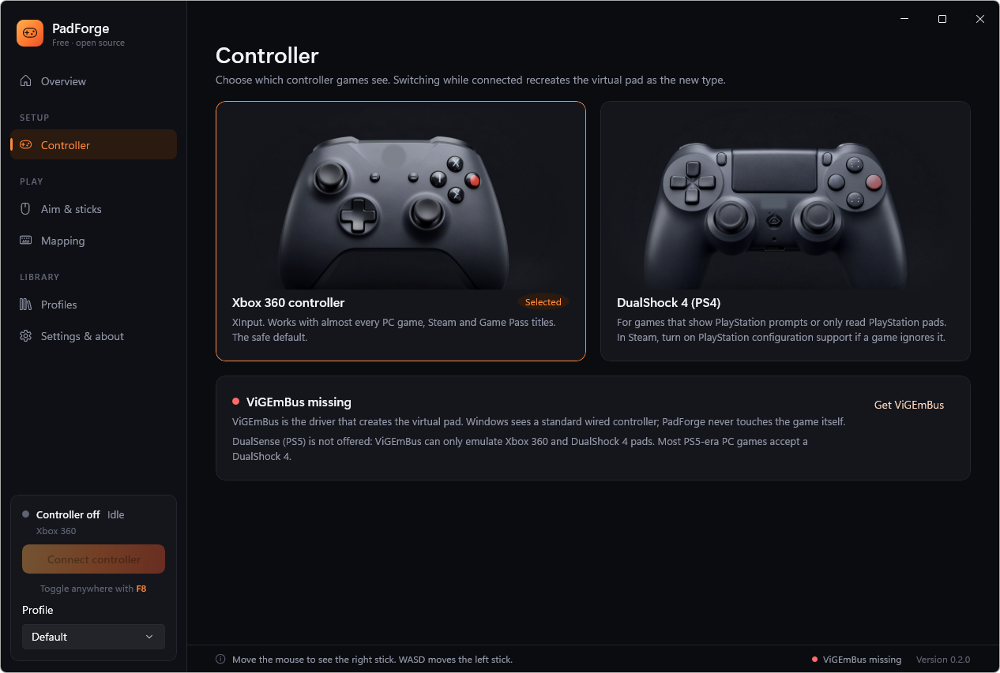
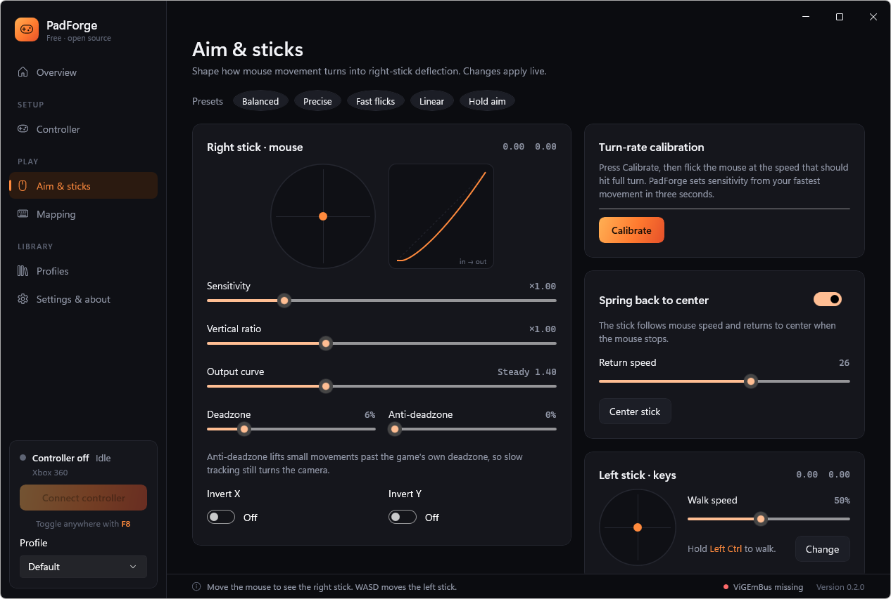
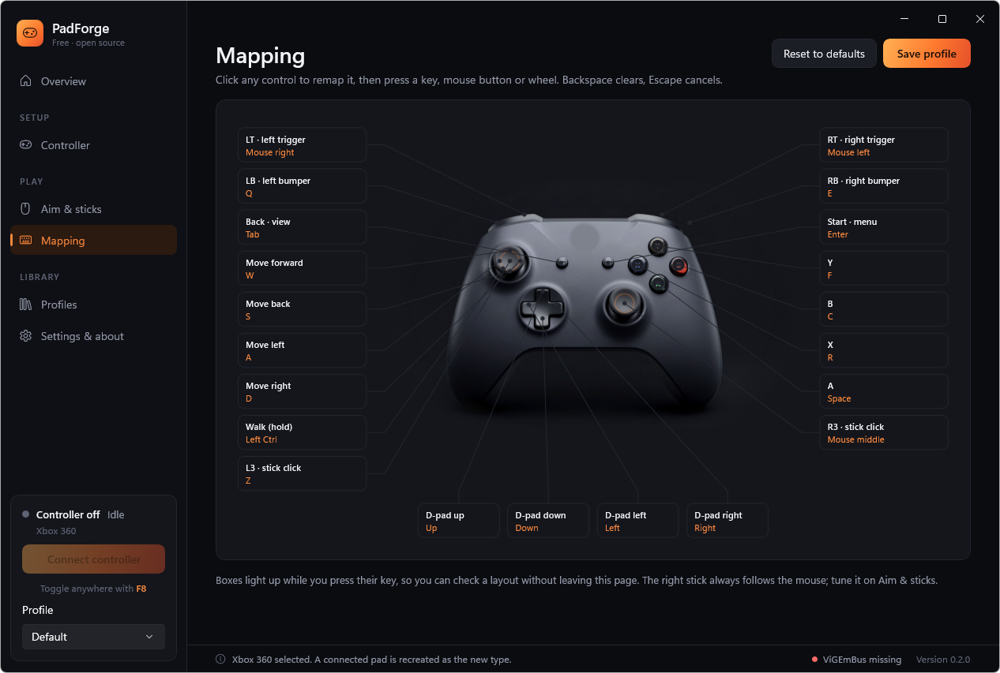
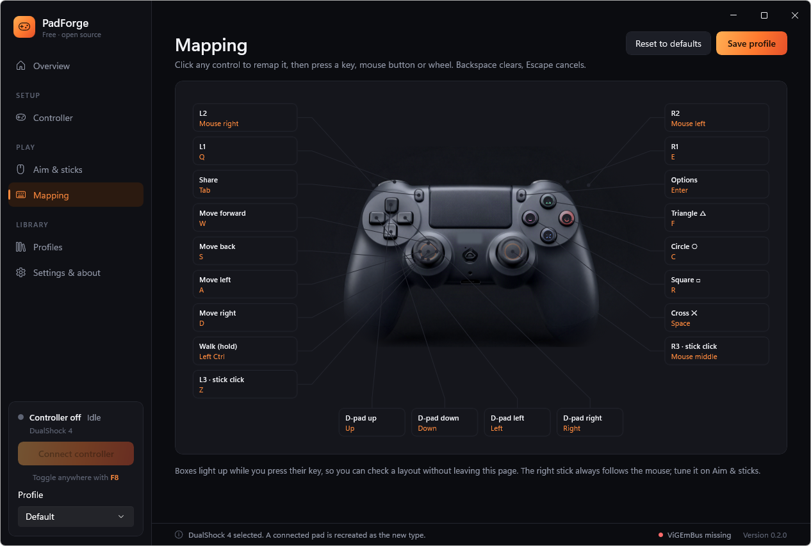

<div align="center">
  
  <h1>PadForge 🎮</h1>
  <p><strong>Free, open-source keyboard and mouse to controller for Windows: a virtual Xbox 360 or DualShock 4 pad, tuned aim and visual mapping, with no account and no paid tier.</strong><br>Built for games that only take a pad, or that give aim assist to controller input.</p>
  <p>
    <a href="https://github.com/PrimeBuild-pc/PadForge/commits/main"></a>
    <a href="https://github.com/PrimeBuild-pc/PadForge/stargazers"></a>
    <a href="https://github.com/PrimeBuild-pc/PadForge/issues"></a>
  </p>
  <p>
    <a href="https://github.com/PrimeBuild-pc/PadForge/actions/workflows/test.yml"></a>
    <a href="https://github.com/PrimeBuild-pc/PadForge/releases"></a>
    <a href="https://github.com/PrimeBuild-pc/PadForge/releases"></a>
    
  </p>
  <p>
    
    
    
    <a href="https://github.com/nefarius/ViGEmBus"></a>
    <a href="LICENSE"></a>
    <a href="https://ko-fi.com/primebuild"></a>
  </p>
  <p><a href="#-features">Features</a> · <a href="#-install">Install</a> · <a href="#-how-input-hiding-works-and-its-limit">Input hiding</a> · <a href="#-build-from-source">Build</a> · <a href="#-testing-on-a-machine-you-also-game-on">Testing</a> · <a href="#-support-the-project">Support</a></p>
</div>

<p align="center"></p>

<p align="center"><sub>PadForge 0.2.0 beta, real screenshot. More below.</sub></p>

PadForge turns your keyboard and mouse into a virtual Xbox 360 or DualShock 4 controller. Games see a real controller while you keep playing on keyboard and mouse. It does not inject code into games: it creates a standard virtual pad through the [ViGEmBus](https://github.com/nefarius/ViGEmBus) driver.

> [!WARNING]
> **Beta.** Expect rough edges and please [report problems](https://github.com/PrimeBuild-pc/PadForge/issues). Use PadForge only in games that allow controller emulators: some anti-cheat systems flag virtual controllers or input hooks.

## ✨ Features

- **Xbox 360 or DualShock 4 output**: pick the pad games see. Mapping labels, the live render and the virtual device follow your choice, and switching while connected recreates the pad. DualSense (PS5) is not available because ViGEmBus cannot emulate it.
- **Mouse to right stick** with sensitivity, a vertical ratio, an output curve, deadzone, anti-deadzone, X/Y invert and spring-back to center (or hold mode).
- **Presets**: Balanced, Precise, Fast flicks, Linear and Hold aim, as starting points.
- **Turn-rate calibration**: flick the mouse for three seconds and PadForge sets sensitivity from your fastest movement.
- **Live view**: stick gauges, a response curve with a live marker, and a controller drawing that lights up as you press.
- **Visual mapping**: click any control on the pad and press a key, mouse button or **mouse wheel** notch.
- **Walk key**: hold a key (Left Ctrl by default) to move the left stick at a set fraction.
- **Hide keys and clicks from the game**: while the pad is sending, mapped keys and mouse buttons stop reaching Windows and the cursor stays still, so the game sees only the controller. Unmapped keys, Alt+Tab and the toggle key keep working.
- **Global toggle hotkey** (F8 by default). Output pauses while PadForge itself is in front, so you can tune safely.
- **Profiles**: create, duplicate, save under a new name and delete them. PadForge reopens the last one you used. Each is a plain JSON file under `%LocalAppData%\PadForge\profiles`.

| Controller | Aim & sticks |
| --- | --- |
|  |  |
| **Mapping (Xbox)** | **Mapping (DualShock 4)** |
|  |  |

The controller renders were generated for PadForge with Higgsfield (Z Image) and edited to remove marks. They are not official product images.

## 📦 Install

1. Install [ViGEmBus](https://github.com/nefarius/ViGEmBus/releases/latest), then restart if the installer asks.
2. Download `PadForge-<version>-win-x64.zip` from [Releases](https://github.com/PrimeBuild-pc/PadForge/releases), extract it anywhere and run `PadForge.exe`. The build is self-contained, so you need no .NET or Windows App SDK install.
3. Click **Connect controller** (or press F8), switch to the game, and play.

Requirements: Windows 10 1809 or later, or Windows 11, x64.

## 🔒 How input hiding works, and its limit

PadForge reads mouse motion with Raw Input and keys with `GetAsyncKeyState`. While the pad is sending and **Hide keys and clicks** is on, low-level keyboard and mouse hooks swallow mapped keys, mapped mouse buttons, mapped wheel notches and cursor movement. PadForge keeps its own state for the keys it swallows, so the pad still sees them.

A release is swallowed only when its press was, so a key never sticks down in Windows when hiding switches on or off. When PadForge comes to the front, sending pauses and hiding stops.

**Limit:** Windows still delivers mouse motion to programs that read it through Raw Input, so games that use Raw Input for the mouse can still see the mouse move. Hiding that needs a separate filter driver. PadForge does not install one, on purpose. Keyboard keys are hidden completely, including from Raw Input.

## 🔨 Build from source

You need the [.NET 8 SDK](https://dotnet.microsoft.com/download/dotnet/8.0).

```powershell
dotnet test tests/PadForge.Core.Tests -c Release
dotnet build src/PadForge/PadForge.csproj -c Release
dotnet run --project src/PadForge/PadForge.csproj -c Release
```

To build the same zip as a release:

```powershell
dotnet publish src/PadForge/PadForge.csproj -c Release -r win-x64 --self-contained -p:Platform=x64 -o out/PadForge
```

Pushing a tag such as `v0.2.0-beta.1` runs [`release.yml`](.github/workflows/release.yml), which tests, publishes and attaches the zip to a GitHub release. Tags with a suffix such as `-beta.1` are marked as pre-releases.

## 📁 Project layout

- `src/PadForge.Core`: mouse-to-stick shaping, the controller report, profiles and the high-priority output loop. It has no WinUI or ViGEm reference, so its tests run anywhere.
- `src/PadForge`: the unpackaged WinUI 3 app, the Raw Input and hook thread (`Platform/InputPump.cs`) and the ViGEm Xbox 360 target.
- `tests/PadForge.Core.Tests`: curve, deadzone, spring, bindings, walk key, input hiding rules, profile migration and the connect/submit loop.
- `tools/PadForge.Smoke`: end-to-end checks against real hardware paths (see below).

## 🧪 Testing on a machine you also game on

ViGEmBus is a kernel driver, and anti-cheat on that Windows installation can see it. Building, the live preview and the unit tests do not need it. To exercise the driver path, use a test virtual machine:

```powershell
# in the VM, after installing ViGEmBus
PadForge.Smoke.exe driver   # creates the pad, drives it through PadEngine, reads it back with XInput
PadForge.Smoke.exe ds4      # creates a DualShock 4 and checks that Windows enumerates it
PadForge.Smoke.exe hooks    # checks key, wheel and cursor hiding with synthetic input only
```

ViGEmBus cannot load inside Windows Sandbox. In a Hyper-V VM, run `driver` from a signed-in desktop session: from a session without a desktop (PowerShell Direct, services), Windows stops delivering the pad's reports after the first few, even to a plain ViGEm writer.

## 💖 Support the project

<div align="center">

[](https://github.com/PrimeBuild-pc/PadForge/issues)
[](https://ko-fi.com/primebuild) [](https://paypal.me/PrimeBuildOfficial)

PadForge is free and will stay free. If it is useful to you, consider starring the repository, reporting problems, sharing feedback, or supporting development with a small donation on [Ko-fi](https://ko-fi.com/primebuild).

</div>

## 📄 License

PadForge is released under the [MIT License](LICENSE).

Copyright (c) 2026 Prime Build.

## 🙏 Credits

PadForge is an original implementation. These projects shaped the idea, and none of their code or artwork is included:

- [ViGEmBus](https://github.com/nefarius/ViGEmBus) and [Nefarius.ViGEm.Client](https://github.com/nefarius/ViGEm.NET) by Nefarius, which provide the virtual Xbox 360 device.
- [Mouse2Joystick](https://github.com/memethyl/Mouse2Joystick) by memethyl, a reference for turning mouse movement into a virtual controller.
- [OmniControl](https://omnicontrol.me), a paid app whose clean layout (sidebar sections, live stick views, callout mapping) inspired PadForge's interface.
