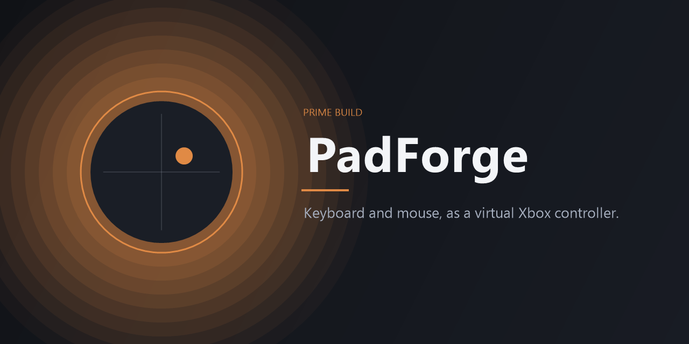

# PadForge



PadForge is an open-source Windows tool that turns keyboard and mouse input into a virtual Xbox 360 controller. Games that only accept a controller, or that offer aim assist to controller input, can see a real XInput device while you keep playing on a keyboard and mouse.

The app is an unpackaged WinUI 3 program (`WindowsPackageType` is `None`). It does not inject code into games. It creates a virtual pad through the [ViGEmBus](https://github.com/nefarius/ViGEmBus) driver and feeds that pad from a background input loop.

## What it does

- Creates and removes a virtual Xbox 360 controller with [Nefarius.ViGEm.Client](https://github.com/nefarius/ViGEm.NET).
- Maps mouse movement to the right stick, with sensitivity, a response curve, a radial deadzone, and optional spring-back to center.
- Maps keyboard and mouse buttons to the face buttons, shoulders, triggers, D-pad, Start, Back, and stick clicks. WASD drives the left stick.
- Toggles the virtual controller with a global hotkey (F8 by default).
- Shows a live stick and button preview. Output pauses while the PadForge window is in front, so you can tune settings without driving the pad.
- Saves profiles as JSON under `%LocalAppData%\PadForge\profiles`.

Spring-back on means the stick follows mouse speed and recenters when the mouse stops. Turn it off to hold the stick where you leave it. **Center stick** clears a held position.

## Prerequisites

- Windows 10 version 1809 or later, or Windows 11
- [.NET 8 SDK](https://dotnet.microsoft.com/download/dotnet/8.0) to build
- [.NET 8 Desktop Runtime](https://dotnet.microsoft.com/download/dotnet/8.0) to run a build that is not self-contained for .NET
- [ViGEmBus](https://github.com/nefarius/ViGEmBus/releases) installed and the machine rebooted if the installer asks for it

The project builds as a self-contained Windows App SDK app, so the Windows App SDK runtime is copied next to the executable. You do not need a separate Windows App Runtime install for the default build.

## Build

From the repository root:

```powershell
dotnet build PadForge.sln -c Release
dotnet test PadForge.sln -c Release
```

Run the app:

```powershell
dotnet run --project src/PadForge/PadForge.csproj -c Release
```

The executable is written under:

```text
src/PadForge/bin/Release/net8.0-windows10.0.19041.0/win-x64/PadForge.exe
```

## How it is split

- `src/PadForge.Core` maps mouse counts to a stick, composes a controller report, stores profiles, and runs the high-priority output loop. It does not reference WinUI or ViGEm, so the mapping tests run without a driver.
- `src/PadForge` is the unpackaged WinUI 3 window, the Raw Input capture thread, and the ViGEm Xbox 360 target.
- `tests/PadForge.Core.Tests` covers the curve, deadzone, spring, bindings, profiles, and the connect/submit loop.

Mouse deltas are observed with Raw Input (`RIDEV_INPUTSINK`) and keys are polled with `GetAsyncKeyState`. Neither path swallows the original input, so the game still sees the keyboard and mouse.

## A PC you also use for games

ViGEmBus is a kernel driver. After it is installed, Windows exposes a virtual gamepad on that installation, and anti-cheat running there can see it. PadForge does not install the driver.

Building, the live preview, and `dotnet test` do not need ViGEmBus. To connect a virtual controller without putting the driver on a machine you play on, install ViGEmBus in a Windows virtual machine and run PadForge there. Windows Sandbox is discarded when it closes, and a kernel driver usually cannot load inside it.

## License

PadForge is released under the [MIT License](LICENSE).

Copyright (c) 2026 Prime Build.

## Credits

PadForge is an original implementation. These projects shaped the idea and the interface, and their code and artwork are not included:

- [Mouse2Joystick](https://github.com/memethyl/Mouse2Joystick) by memethyl, a reference for turning mouse movement into a virtual controller.
- [OmniControl](https://omnicontrol.me), for the clarity of a live stick view, curves, and calibration. The PadForge layout is its own.
- [ViGEmBus](https://github.com/nefarius/ViGEmBus) and [Nefarius.ViGEm.Client](https://github.com/nefarius/ViGEm.NET) by Nefarius, which provide the virtual Xbox 360 device.
